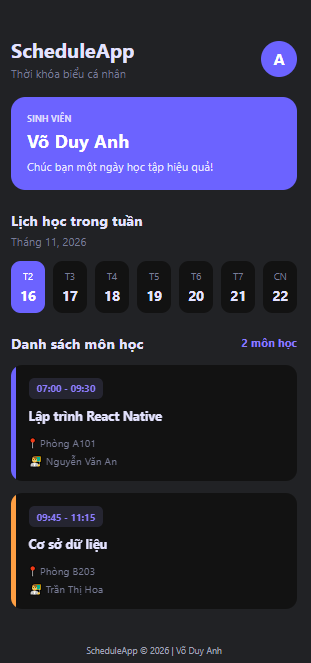
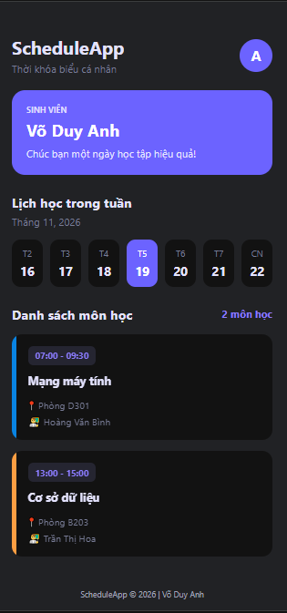
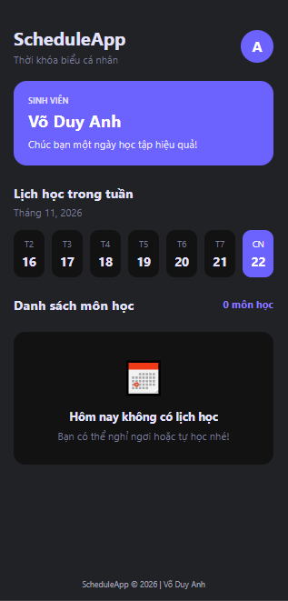

## 1. Link ứng dụng Expo

https://snack.expo.dev/@voduyanh/scheduleapp

## 2. Các dòng code và hình ảnh sự thay đổi giao diện của các thành phần trong component và các component

### Các component được sử dụng

- `Header.js`
- `StudentInfo.js`
- `DaySelector.js`
- `ScheduleHeader.js`
- `ScheduleItem.js`
- `EmptySchedule.js`
- `Footer.js`

### Hình ảnh giao diện ứng dụng

**Giao diện chính**

**Giao diện chọn ngày**

**Giao diện không có lịch học**

